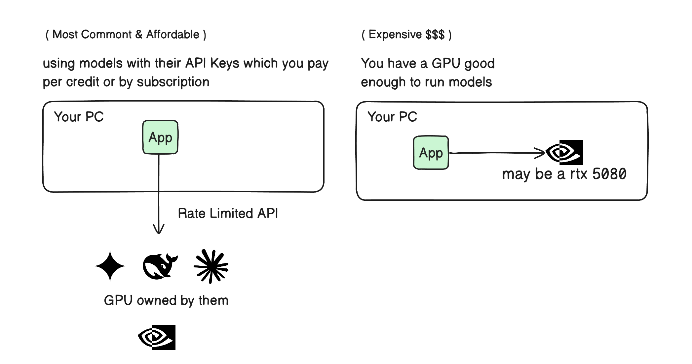
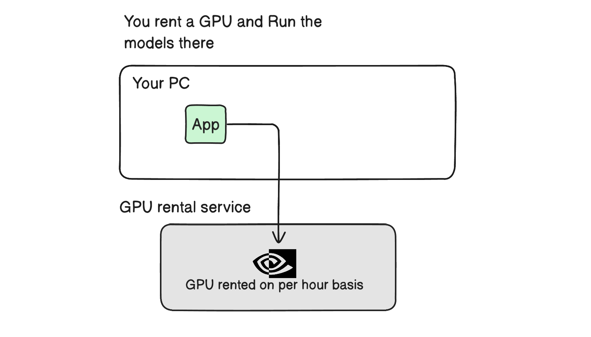
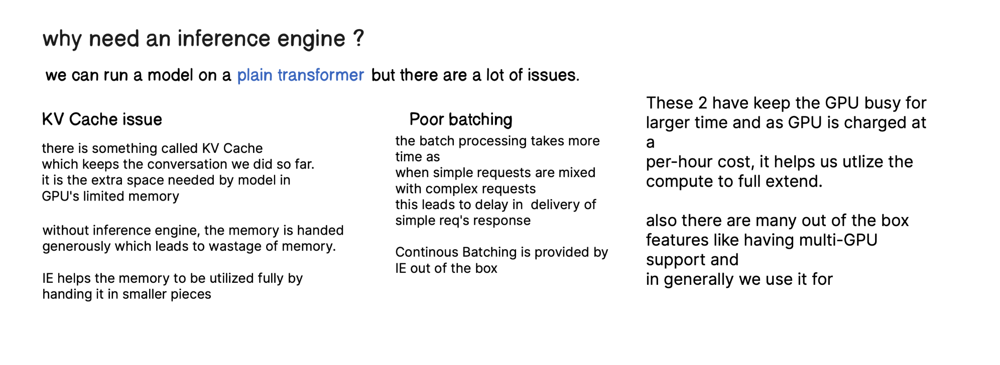
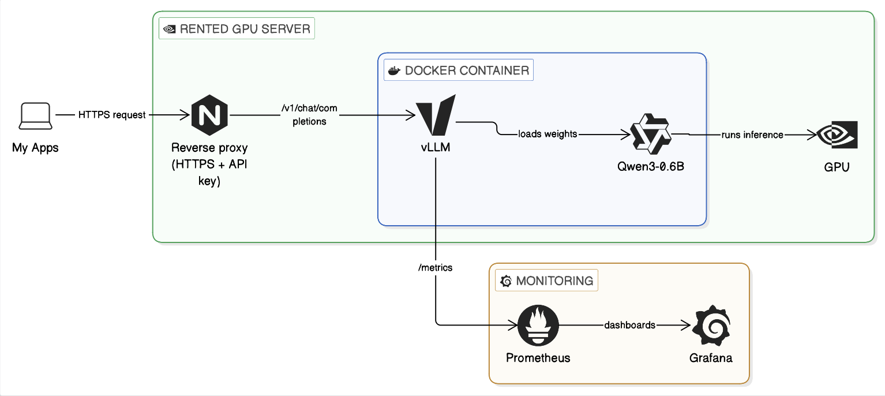

# llm-inference-platform

This is one those projects which i really wanted to do but never got much time to do so, finally i got that time to make it so i will be doing it.

I have the plan to eventually make it a big platform and my goal is learning how to handle AI / LLM at a decent scale. 

The thing which made me move towards this project was my constant use of Gemini,OpenCode,DeepSeek APIs and I wanted to know how all this model handling operates at a massive scale.

---

## The First Steps
The simplest inference thing will be running a model on a gpu and connecting it to my computer by some means. basically taking the GPU compute from local to cloud. Most the companies like Gemini and DeepSeek may have in-House Data centers but we will try this with a rented GPU.

### Plan 1 : Running a small model on a GPU which is rented in cloud and connecting it to my apps and openCode.

Generally what we do is use either of the 2 options, even second option is really rare, the most used option is using APIs from major AI providers 

  

but there is an issue here. Higher rate limits cause much more money and we don't control the pricing much.

There is a third option also which is using a rented GPU 

  

suppose we get the rented GPU from somewhere 
(// TODO : i will add the rental gpu details from where later), 
to run a model we need to have a few things.
first the GPU instance should have NVIDIA drivers and CUDA installed.It is generally pre-installed but still have a look.
then we need an inference engine:

> why need an inference engine ?
> 
> 

>   
> 

there are a few options like vLLM, llama.cpp, Ollama etc. but vLLM is more suitable for bigger models / scale.
you can use other options like Ollama and llama.cpp for smaller models for local use.

### The Thing I have made as the first step in the project

  

